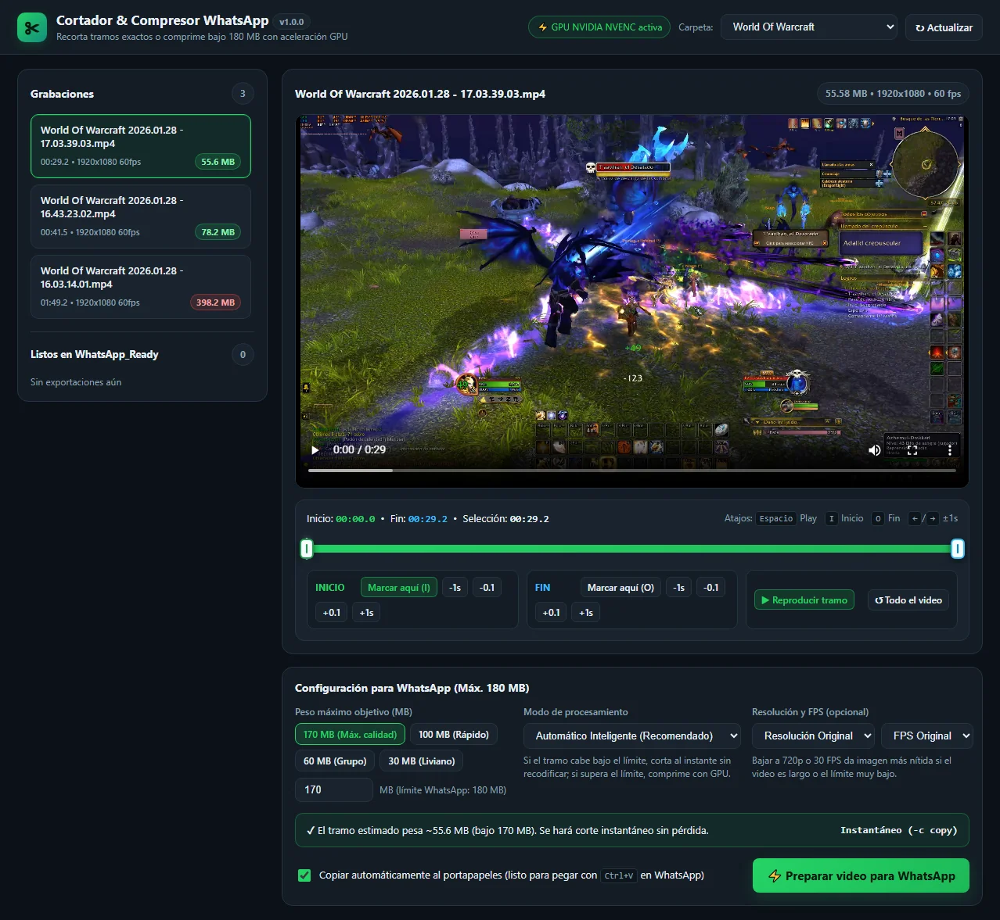

<div align="center">
  
  <h1>WhatsApp Video Cutter</h1>
  <p><strong>Cortador y compresor visual de grabaciones para WhatsApp (&lt; 180 MB) con aceleración por GPU NVIDIA NVENC.</strong></p>

  <p>
    
    
    
    
    
    
    
    
  </p>
</div>

---

## 🖼️ Vista previa

<div align="center">
  
</div>

## ✨ Características principales

- **Interfaz web oscura e intuitiva**: reproductor HTML5 con soporte de streaming HTTP `Range` (`206 Partial Content`) para adelantar y retroceder grabaciones pesadas al instante.
- **Línea de tiempo de doble cabezal (`Inicio` / `Fin`)**: ajuste fino (`±0.1s`, `±1s`) y vista previa exacta del tramo seleccionado.
- **Cuatro modos de procesamiento**:
  - `Automático Inteligente`: si el tramo recortado cabe bajo el límite, corta al instante sin recodificar (`-c copy`); si lo supera, comprime con GPU `h264_nvenc` (o `libx264` como respaldo).
  - `Comprimir siempre con GPU`: ajusta automáticamente el bitrate para respetar el límite configurado (`170 MB`, `100 MB`, `60 MB`, `30 MB` o personalizado).
  - `Corte instantáneo`: recorta sin recodificar ni perder calidad.
  - `Dividir en partes`: divide el tramo en segmentos iguales menores al límite.
- **Integración con Windows**: copia automática al portapapeles (`FileDropList`) para pegar directo con `Ctrl+V` en WhatsApp y acceso rápido a la carpeta de salida `WhatsApp_Ready`.
- **Portable y contenedorizado**: compilable a ejecutable `.exe` versionado (`v1.0.0.0`) y listo para ejecutar en Docker / Docker Compose.

## 🛠️ Tecnologías utilizadas

| Componente | Tecnología | Uso |
| --- | --- | --- |
| Backend & API | Python 3.10+ (`http.server`, `socketserver`) | Servidor HTTP/1.1 multihilo sin dependencias externas en runtime |
| Procesamiento de video | FFmpeg / FFprobe + `h264_nvenc` | Análisis, corte sin pérdida, división y compresión GPU/CPU |
| Interfaz visual | HTML5 + CSS3 + JavaScript | Reproductor, barra dual de recorte y estimación en vivo |
| Empaquetado | PyInstaller + Pillow | Generación de icono `.ico` y compilación a `.exe` |
| Contenedores | Docker + Docker Compose | Imagen `python:3.10-slim` + `ffmpeg` con `HEALTHCHECK` |
| Pruebas | Pytest | Suite unitaria y de integración HTTP/FFmpeg |

## 📋 Requisitos

- **Python 3.10+**
- **FFmpeg y FFprobe** disponibles en el `PATH` del sistema (ya incluidos dentro de la imagen Docker).
- *(Opcional)* GPU NVIDIA compatible con `h264_nvenc` para compresión acelerada por hardware.

## 🚀 Instalación y uso en `.venv`

```powershell
# 1. Crear el entorno virtual
python -m venv .venv

# 2. Instalar dependencias de desarrollo (pytest, pillow, pyinstaller)
.\.venv\Scripts\python.exe -m pip install -r requirements-dev.txt

# 3. Iniciar la aplicación
.\.venv\Scripts\python.exe whatsapp_cutter.py
```

En Windows también puedes hacer doble clic en `Iniciar_WhatsApp_Cutter.bat`, que verifica o crea `.venv` automáticamente y abre el navegador en `http://127.0.0.1:8765`.

### Parámetros de línea de comandos

```text
python whatsapp_cutter.py [--host 127.0.0.1] [--port 8765] [--videos-dir RUTA] [--default-folder CARPETA] [--no-browser] [--version]
```

## ⌨️ Atajos de teclado

| Tecla | Acción |
| --- | --- |
| `Espacio` | Reproducir / Pausar |
| `I` | Marcar punto de **Inicio** en el segundo actual |
| `O` | Marcar punto de **Fin** en el segundo actual |
| `←` / `→` | Retroceder / Avanzar `1s` (`Shift` para `±5s`) |

## 📦 Compilar ejecutable `.exe`

```powershell
.\scripts\build_exe.ps1
```

Genera el icono multi-resolución en `assets/app_icon.ico` y compila `dist/WhatsAppVideoCutter.exe` con metadatos de versión `1.0.0.0`.

> El `.exe` requiere `ffmpeg.exe` y `ffprobe.exe` disponibles en el `PATH` del sistema.

## 🧪 Tests

```powershell
.\.venv\Scripts\pytest.exe -v
```

La suite crea un MP4 sintético en un directorio temporal sin tocar tus grabaciones reales.

## 🐳 Docker

### Con Docker Compose

```powershell
# Opcional: copiar .env.example a .env para ajustar VIDEOS_DIR, WA_PORT y WA_DEFAULT_FOLDER
docker compose up --build -d
```

Luego abre `http://127.0.0.1:8765` en tu navegador y utiliza el botón **Descargar** o revisa la subcarpeta `WhatsApp_Ready`. Para detener el contenedor:

```powershell
docker compose down
```

### Con Docker CLI

```powershell
docker build -t whatsapp-video-cutter:1.0.0 .
docker run -d --name whatsapp-cutter -p 8765:8765 -v "%USERPROFILE%\Videos:/videos" whatsapp-video-cutter:1.0.0
```

## 📡 API REST

- `GET /api/health` — Estado del servicio, versión y disponibilidad de NVENC.
- `GET /api/folders` — Carpetas detectadas dentro de la raíz configurada.
- `GET /api/videos?folder=...` — Listado de videos y exportaciones en `WhatsApp_Ready`.
- `GET /api/video?path=...` — Streaming MP4 con soporte `Range` (`206 Partial Content`).
- `GET /api/download?path=...` — Descarga directa (`Content-Disposition: attachment`).
- `POST /api/process` — Recorte, compresión o división de video.
- `POST /api/clipboard` — Copia archivos al portapapeles de Windows.
- `POST /api/reveal` — Abre la ubicación del archivo en el Explorador de Windows.

## 📄 Licencia

Distribuido bajo licencia [MIT](LICENSE).

---

<div align="center">
  Desarrollado por <strong>Rodrigo Angeloni</strong>
</div>
